<p align="center">
  
</p>

<h1 align="center">readability</h1>

<p align="center">
  <b>Audit how readable — and how comfortable to read — a website really is.<br/>
  Contrast, typography, line length, clarity, structure, accessibility. Measured in a real browser.</b>
</p>

<p align="center">
  <a href="#license"></a>
  
  <a href="https://github.com/pi-infected/readability/actions"></a>
  
</p>

<p align="center">
  <a href="#give-it-to-your-agent">Install</a> ·
  <a href="#measure-only-what-you-need">Recipes</a> ·
  <a href="#commands">Commands</a> ·
  <a href="#for-ai-agents">For AI agents</a> ·
  <a href="docs/METHODOLOGY.md">Methodology</a>
</p>

**Give your AI agent a reader's eye.** One tool call opens the page in a real browser,
measures what a reader actually meets, and returns each problem with its evidence and a fix.

| Your agent can check | What is measured | Selector |
| --- | --- | --- |
| ◐ **Contrast** | WCAG 2.2 ratio and APCA Lc (WCAG 3 draft), resolved through the real background, per size and weight | `--only contrast` |
| **Aa Typography** | body size, text below 16px, line height, paragraph spacing, capitals, justification, type scale | `--only typography` |
| ↔ **Line length** | characters per line from real line boxes, desktop and phone | `--only measure` |
| ▯ **Mobile** | body size and line length at 390px, sideways scrolling | `--only mobile` |
| ▣ **Layout** | sticky headers, cookie walls and chat bubbles covering the first screen, layout shift | `--only layout` |
| ¶ **Clarity** | LIX, Flesch per language, Fog, SMOG, sentence length, passive voice, filler, rare words | `--only clarity` |
| ☰ **Structure** | heading density, walls of text, paragraph length, links, title and meta description | `--only structure` |
| ♿ **Accessibility** | declared vs detected language, alt text, heading order, link text, acronyms, text scaling | `--only access` |

Each check runs alone in seconds, or all together across a whole site.

```sh
readability page https://site.com --only contrast --format json   # what your agent runs
```

```json
{"key": "apca_fail", "severity": "medium", "title": "3 text blocks are perceptually thin",
 "fix": "Raise the contrast or the font size for these blocks.",
 "evidence": [{"text": "Une installation, zéro config…", "color": "rgb(107, 100, 87)",
               "background": "rgb(238, 232, 220)", "ratio": 4.8, "apca_abs": 66.0,
               "apca_required": 92.5, "font_px": 15.5}]}
```

### Give it to your agent

```sh
git clone https://github.com/pi-infected/readability && cd readability
pip install -e . && pip install playwright && playwright install chromium
cp -r skills/readability ~/.claude/skills/        # Claude Code; other agents: AGENTS.md
```

Then ask: *"Is my pricing page easy to read? Fix what you find."* The agent picks the
checks it needs, fixes the CSS or the text the evidence points to, and re-measures.

## Why readability

- **Measured, not guessed.** Most readability tools stop at a Flesch score, which cannot see
  12px body text, a 2.6:1 contrast, a 140-character line or a page declaring `lang="en"`
  over French prose. readability reads computed styles and line boxes in headless Chromium.
- **Narrow and fast.** Measure only what you ask for. A selection that needs no browser
  skips it: a text-only audit of 8 pages runs in about 4 seconds.
- **Honest.** A page with no readable text scores `n/a`, not a made-up number. Terminal
  demos and JSON blobs are not scored as prose. Targets are calibrated against a reference
  set of well-typeset sites and validated on 107 labelled difficulty pairs
  ([methodology](docs/METHODOLOGY.md)).
- **Agent-ready.** `--format json` everywhere, stable exit codes, evidence and a fix on every
  finding, and a ready-made [skill](skills/readability/SKILL.md).

## Install (command line)

```sh
git clone https://github.com/pi-infected/readability
cd readability
pip install -e .                 # or: uv pip install -e .
pip install playwright && playwright install chromium   # once, for the rendered pass
readability metrics                 # check it works: lists everything you can measure
```

Without Playwright, readability still runs every text, structure and accessibility metric —
only the rendered *comfort* metrics (contrast, typography, layout) need the browser.

## Measure only what you need

A full audit renders every page twice (desktop + mobile) and runs ~40 metrics. Most of the
time you want one thing. Select it, and readability does only the work that thing needs.

| You want | Command | Browser |
| --- | --- | --- |
| Contrast of one page (WCAG + APCA) | `readability page URL --only contrast` | desktop only |
| Typography without the phone pass | `readability page URL --only typography --skip mobile` | desktop only |
| Is my mobile layout readable? | `readability page URL --only mobile` | both |
| How hard is my writing? | `readability page URL --only clarity` | none |
| Just the classic formulas | `readability text draft.md --only readability` | none |
| Whole blog, text only, fast | `readability audit https://site.com --include '/blog/' --pages 100 --only clarity,structure` | none |
| Everything except SEO nits | `readability audit https://site.com --skip seo` | both |
| Check a few exact pages | `readability page URL1 URL2 URL3` | both |
| Accessibility, minus the browser | `readability page URL --only access --skip rem_scaling` | none |

Selectors are **pillars**, **groups** or single **metrics**, comma-separated and repeatable.
`readability metrics` prints them all.

- **Pillars:** `clarity` · `structure` · `comfort` · `access`
- **Groups:** `readability` · `style` · `contrast` · `typography` · `layout` · `mobile` ·
  `headings` · `links` · `seo` · `images`
- **Metrics:** `lix`, `flesch`, `asl`, `passive`, `font_size`, `line_height`, `measure`,
  `contrast`, `apca`, `occlusion`, `cls`, `alt_coverage`, `rem_scaling`… (40 in all)

### Choose which pages

```sh
readability urls https://site.com --pages 200              # dry run: what would be audited
readability audit https://site.com --pages 50 \
  --include '/en/' --exclude '/tag/' --exclude '/page/[0-9]+'   # repeatable regexes
readability audit https://site.com --url-list https://site.com/a https://site.com/b
readability audit https://site.com --no-sitemap --depth 1  # links from the home page only
```

Discovery reads `sitemap.xml` first, then crawls same-origin links. `robots.txt` is
respected, responses are cached on disk, duplicates (redirects, canonicals, identical
bodies) are analysed once.

## Commands

| Command | What it does |
| --- | --- |
| `readability page URL…` | Analyse one or more pages, no crawl. Prints metrics, findings and evidence. |
| `readability audit URL` | Crawl a site, score every page, write JSON / CSV / HTML / PDF reports. |
| `readability text FILE` | Analyse a local Markdown, text or HTML file (`-` for stdin). JSON out. |
| `readability urls URL` | List the pages an audit would visit, without analysing them. |
| `readability metrics` | List every pillar, group and metric you can pass to `--only` / `--skip`. |
| `readability diff A.json B.json` | What changed between two audits: score delta, resolved and new findings. |
| `readability benchmark URL URL…` | Audit several sites the same way and rank them. |

### Options

```text
selection   --only SEL          measure only these pillars / groups / metrics
            --skip SEL          leave these out
            --no-render         never start the browser
pages       --pages N           page budget (audit 10, urls 50)
            --include RE        URL must match one of these   (repeatable)
            --exclude RE        URL must not match any        (repeatable)
            --url-list A B C    exactly these URLs, no crawl
            --depth N           link-crawl depth (default 2)
            --no-sitemap        crawl links only
            --delay S           politeness delay (default 0.4s)
            --ignore-robots     only for sites you own
targets     --audience A        general · technical · academic · children
            --lang fr           force the language of the linguistic metrics
            --config FILE       TOML/JSON: bands, weights, only/skip (see below)
output      --format json       machine-readable result on stdout
            --out DIR           readability.{json,csv,html,pdf} in DIR
            --json/--csv/--html/--pdf PATH
            --report-lang en fr reports in one or more languages, one crawl
            --screenshots       desktop screenshot per page in the report
            --evidence N        evidence lines per finding (page, default 2)
            --fail-under N      exit 2 below this score (CI gate)
speed       --concurrency N     pages rendered at once, clamped to free RAM
            --no-cache          always refetch
```

### Reports

```sh
readability audit https://site.com --pages 30 --out report/ --report-lang en fr --screenshots
```

writes `readability.json` (the single source of truth: every value, its target, its evidence,
the methodology and coverage), `readability.csv` (one row per page), and an HTML + PDF report
per language — all from the same crawl. `readability diff before.json after.json` closes the
loop when you ship a fix.

### Tune the targets

The bands are data, not code ([`examples/readability.toml`](examples/readability.toml)):

```toml
only = ["comfort", "access"]   # same selectors as --only / --skip
skip = ["seo"]
disable = ["meta_description"]

[bands.measure]                # our column is deliberately narrow
ideal = [45, 72]
tolerable = [35, 88]

[weights]
contrast = 2.5

[pillar_weights]
comfort = 0.35
```

## For AI agents

readability is built to be driven by coding agents (Claude Code, Codex, Cursor, Copilot…):

- **`--format json`** on every command: result on **stdout**, progress on **stderr**.
- **Narrow first.** `--only` keeps the payload small and the run fast; `readability metrics
  --format json` lists every valid selector.
- **Exit codes:** `0` ok · `1` (`page`) a URL could not be fetched or parsed · `2` below
  `--fail-under` · `64` bad selector.
- Every finding carries `key`, `severity`, `pillar`, `detail`, `fix` and `evidence`
  (the text, its colours, size, ratio, APCA level), so the agent can go straight to the
  CSS or the sentence.

```sh
readability page https://site.com/pricing --only contrast,typography --format json \
  | jq '.findings[] | {key, severity, fix, evidence: .evidence[:2]}'
```

Install the skill so your agent knows when and how to use it:

```sh
mkdir -p ~/.claude/skills && cp -r skills/readability ~/.claude/skills/   # Claude Code
```

Other agents: point them at [`AGENTS.md`](AGENTS.md).

How each number is produced, calibrated and validated: [docs/METHODOLOGY.md](docs/METHODOLOGY.md).

## Built on

[Playwright](https://playwright.dev) (rendering) · [trafilatura](https://github.com/adbar/trafilatura)
and [readability-lxml](https://github.com/buriy/python-readability) (content extraction) ·
[textstat](https://github.com/textstat/textstat) (cross-check) · [wordfreq](https://github.com/rspeer/wordfreq) (vocabulary rarity) · [pyphen](https://github.com/Kozea/Pyphen)
and [syllapy](https://github.com/mholtzscher/syllapy) (syllables) · [WeasyPrint](https://weasyprint.org) (PDF) ·
WCAG 2.2 contrast and [APCA](https://github.com/Myndex/apca-w3) implemented from the specifications.

## Development

```sh
pip install -e . pytest && python -m pytest -q          # browser tests need Chromium
python -m pytest -q -m "not render"                     # offline subset
```

Issues and pull requests welcome.

## License

Licensed under either of [Apache License, Version 2.0](LICENSE-APACHE) or
[MIT license](LICENSE-MIT), at your option (`MIT OR Apache-2.0`).
